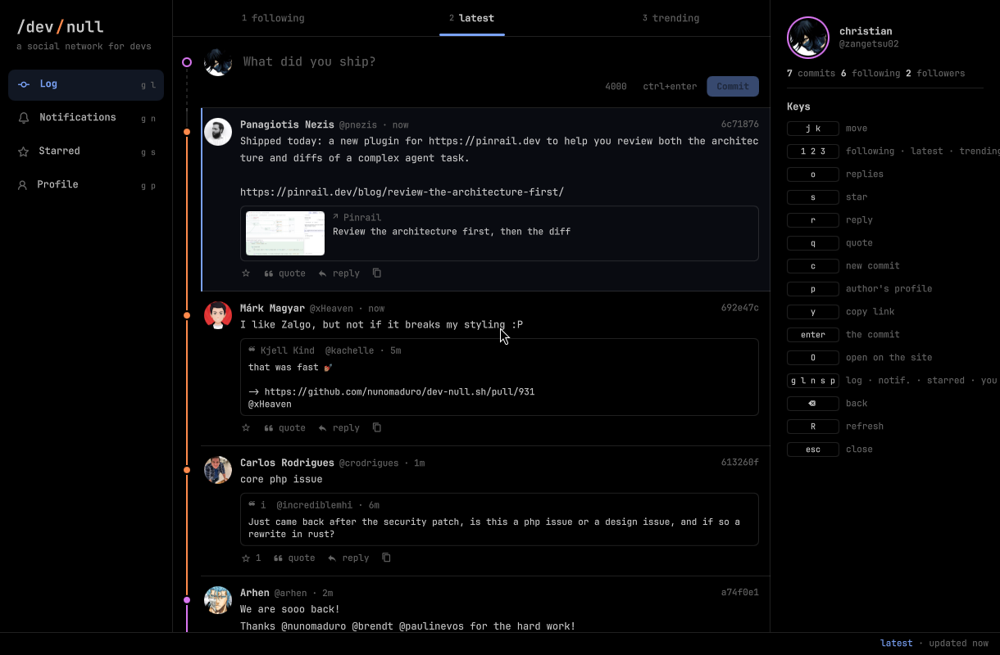
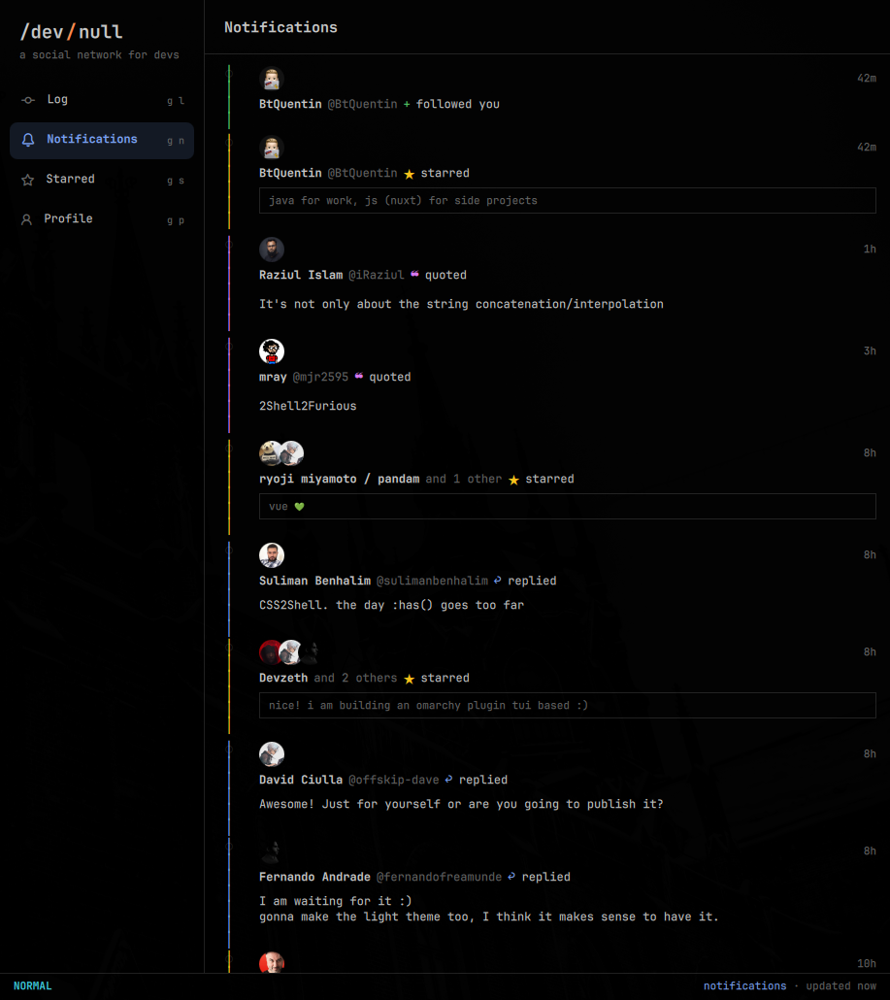
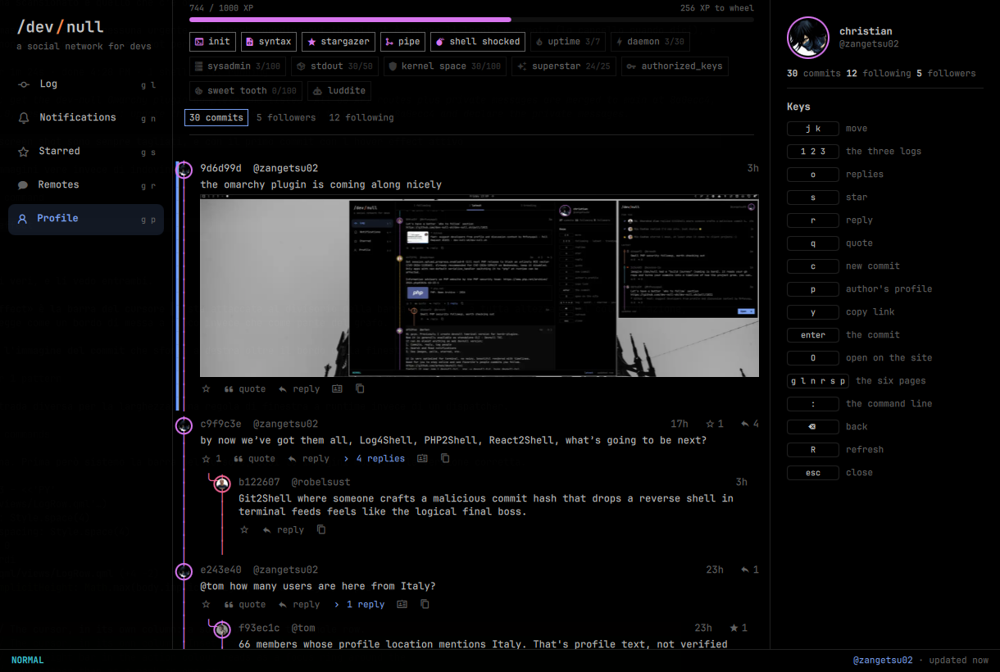

# dev-null

[dev-null.sh](https://dev-null.sh), the social network for developers, inside
the [Omarchy](https://omarchy.org) shell, so you can read it without keeping a
browser tab open. There are three surfaces.

- The bar: an icon that stays dark until something is unread, with the count.
- The popup (click the icon): who reached you and the last three commits.
  `o` or Open goes to the full client.
- The full client: the following, latest and trending logs on a commit graph,
  threads opened in place, notifications, your starred commits and anyone's
  profile, with pictures and link cards drawn in place. Star, reply, quote,
  commit and follow without leaving it.

It is drawn the way a terminal draws. The commit graph is box-drawing
characters rather than shapes, a pane names itself in its own top border, and
the last two rows are a status line and a `:` prompt. Background, text and font
come from the Omarchy theme; the author lanes use dev-null's own palette.

On a machine that has never been connected it shows the real Latest log,
read-only, taken from the page dev-null already serves to everyone. There is
one `[ connect ]` in the status line and the feed underneath it.



*Signed out: the real Latest log, read from the page dev-null serves everyone,
with one `[ connect ]` in the status line.*

| Notifications | A profile |
|---|---|
|  |  |

## Install

```bash
omarchy plugin add https://github.com/zangetsu02/omarchy-devnull.git --enable
```

That puts the badge on the right of the bar. Then pair this machine once
(see [Setup](#setup)).

### Needs

Everything here is on a standard Omarchy install.

| Package | For |
|---|---|
| `python` | `scripts/devnull`, the bridge to dev-null.sh (standard library only) |
| `openssh` | `ssh-keygen`, which makes and uses the device key |
| `xdg-utils` | opening links, and the `devnull://` handler for pairing |
| `wl-clipboard` | `y`, copying a commit's link |
| `qt6-imageformats` | pictures: dev-null serves them as WebP |
| a Nerd Font | the action icons; Omarchy's monospace font is one |

### A floating window

So that the full client floats, centred and opaque, instead of joining the
tiling layout with the see-through default every window gets,
add this to `~/.config/hypr/hyprland.lua` and run `hyprctl reload`:

```lua
o.window({ class = "^org.quickshell$", title = "^dev-null$" }, { float = true, tag = "-default-opacity", opacity = "1 1" })
o.window({ class = "^org.quickshell$", title = "^dev-null$" }, { size = { "(min(1220, monitor_w*0.92))", "(min(800, monitor_h*0.85))" } })
o.window({ class = "^org.quickshell$", title = "^dev-null$" }, { center = true })
```

Size comes before centring, and the `min()` keeps it inside a small or
vertical monitor. The plugin never edits this file for you.

## Keys in the full client

| Keys | What they do |
|---|---|
| `j` `k` (or arrows) | move between commits |
| `1` `2` `3` | following · latest · trending |
| `o` | show or hide the replies |
| `s` · `r` · `q` | star · reply · quote |
| `c` | write a commit (`ctrl+enter` sends it) |
| `p` | the author's profile |
| `enter` · `O` · `y` | the commit page · open it on the site · copy the link |
| `g l` `g n` `g s` `g p` | log · notifications · starred · your profile |
| `⌫` · `R` · `esc` | back · refresh · close |
| `:` | the command line (below) |

### The command line

`:` is for what a single key does not deserve. It opens a prompt on the last
row with completion as you type; `Tab` takes the first thing still on offer,
`enter` runs it and `esc` leaves. Every command does something a key already
does.

| Command | What it does |
|---|---|
| `:log following` · `:log latest` · `:log trending` | switch log |
| `:notifications` · `:starred` · `:profile @someone` | go there |
| `:star` · `:reply` · `:open` · `:copy` | act on the commit under the cursor |
| `:refresh` · `:connect` · `:quit` | reload · pair this machine · close |

An unknown command answers the way vim does, and `:log` refuses a log that does
not exist rather than emptying the feed.

### The mouse

It works throughout, the way `mouse=a` works in LazyVim. There is one marker,
the cursor line, and the mouse moves it; content never lights up under the
pointer. Buttons and links still answer to it.

A click moves the cursor. Double click does what `enter` does. The wheel
scrolls, the avatar opens a profile, and a commit's body is selectable: drag
across it and copy as you would in a terminal.

Click a picture to see it full size; there `←` `→` step through a commit's
pictures, `enter` opens the one in front in the browser and `esc` closes it.

## Why it pairs a device instead of logging in

dev-null has a real API, the one its mobile app uses. It authenticates each
request by its signature, made with an SSH key you approved as a device. So:

- No cookie is borrowed from your browser and no password is stored anywhere.
- The key is made here, lives in `~/.local/share/omarchy-devnull`, and is never
  added to your SSH agent or uploaded to GitHub. It does not need to be on
  GitHub: approving it on the site is the proof.
- Every signature is scoped to the `devnull-api` namespace, which is the only
  thing it is good for. It cannot sign a git commit and it cannot log you in
  anywhere else.

The signed message is the timestamp, a nonce, the method, the path and the body,
and it travels in three headers. `scripts/devnull` is the only thing that
touches the key; the QML asks it and reads JSON back.

## Setup

```bash
~/.config/omarchy/plugins/io.github.zangetsu02.devnull/scripts/setup-devnull
```

It makes the key, registers a handler for `devnull://` links, opens the approval
page in your browser, and redeems the code that comes back. One minute, once.

Then, if you have never done it, accept the commit rules on dev-null.sh. Until
you do, the server refuses every reply you send, from here, from the app, from
anywhere.

## Remove

```bash
omarchy plugin remove io.github.zangetsu02.devnull
```

That takes the plugin and its badge away. Pairing left three things of its own,
which go with it if you want a clean machine:

```bash
rm -rf ~/.local/share/omarchy-devnull                              # the device key
rm ~/.local/share/applications/omarchy-devnull-callback.desktop    # the devnull:// handler
update-desktop-database ~/.local/share/applications
```

Then revoke the device on dev-null.sh under **Settings → Devices**, and drop
the three window rules from `hyprland.lua` if you added them.

## Settings

| Setting | Default | What it does |
|---|---|---|
| Unread check while closed | 60s | Fetches only the unread count. See below. |
| Feed refresh while open | 20s | Reloads the popup's feed while you are looking at it. |
| Lines shown | 2 | Lines of each commit in the popup; the full client shows them whole. |

## Worth knowing

The badge counts every kind of notification: replies and mentions, but also
stars, follows and moderation outcomes. The only count that can be fetched
without side effects is a single total, with no breakdown. The next paragraph
is why that matters.

Opening the panel marks your notifications read, on the website and in the
official app too. Listing notifications is what marks them read, upstream,
whatever filter you ask for. So the closed panel only asks for the count, and
the list is fetched once, when you open it, because opening it is reading them.

Once you click "older…", the feed stops refreshing by itself, so it cannot
throw away what you scrolled to. Close and reopen the panel to get back to the
top.

Signed out, what you see is the live site. dev-null is server rendered, so its
home page carries the whole Latest log as JSON. With no key the plugin reads
that, derives the short hashes the way the site's own `CommitResource` does,
and hands the views the shape the API would have given them. Starring and
replying need the pairing.

A reply can come back held. dev-null moderates commits from accounts without
"good reputation", so yours may be pending for a while. The panel shows the
state the server returned.

## When it breaks

The icon goes crossed after three refusals in a row from a device that is no
longer approved, and the panel tells you to run the setup again. Opening the
panel then probes once, so a machine you have just re-paired is noticed without
restarting the shell.

A wrong clock, a dead network and a machine that was never connected all look
different on purpose. Upstream answers 401 for both a refused device and an
expired signature, so the plugin reads the error code in the body rather than
the status. A clock six minutes out tells you to check the clock.

## Limits

`devnull://` is the official app's URL scheme, and pairing borrows its flow.
It works, your account is your own, but this is not a sanctioned third-party
API: if that flow ever closes, pairing stops working. Nothing else here depends
on it once the device is approved.

The site is weeks old and its API is undocumented. Shapes can change.

## How it is put together

```
manifest.json  README.md  LICENSE  preview.png
qml/
  Panel.qml        the bar icon and its popup (entry point)
  FullPanel.qml    the full client: layout, keys, navigation (entry point)
  data/            Service.qml, Pager.qml and Model.js: state and pure logic
  views/           the client's pages and rows, the composer, the pictures
  ui/              shared building blocks: Mono, Metrics, Rail, FrameLine,
                   LinkText, ActionButton, Avatar, Picture
scripts/
  devnull          the only thing that talks to dev-null.sh: signs each request, prints JSON
  setup-devnull    pairing, once (with devnull-callback)
tests/             tests/run, all against a mock of dev-null.sh
```

`Model.js` holds every decision that can be made without QML: what to call
when, how a commit becomes a row, the palette, the rail glyphs, the two halves
of a header line, a frame's border. That is what node can test. Rows and pages
only talk to `FullPanel`, which is the one that knows the service.

Two components keep the grid honest. `ui/Metrics.qml` owns the font size the
grid is measured at, along with the cell width and the line pitch, so nothing
can measure at one size and paint at another. `ui/Rail.qml` draws the graph
rail, so the log, the notifications and the bar popup cannot drift apart.

Every glyph the grid draws is declared in one place, `Model.GLYPHS`. A glyph
the monospace font lacks falls back to another face at another width and shears
every line under it, so `tests/glyph-test` asks fontconfig who serves each one
and fails if any answer is not the grid font. Counting code points cannot catch
that.

## Tests

```bash
tests/run
```

Nine files. Nothing there touches dev-null.sh: `tests/mock-devnull` stands in
for it, so no test ever posts a real commit. The mock verifies the signatures
it is sent with `ssh-keygen -Y verify`, so a request that would be refused
upstream is refused here too.

`tests/glyph-test` is the odd one. It asks fontconfig rather than node, because
whether a glyph is one cell wide is a question only the font can answer.
