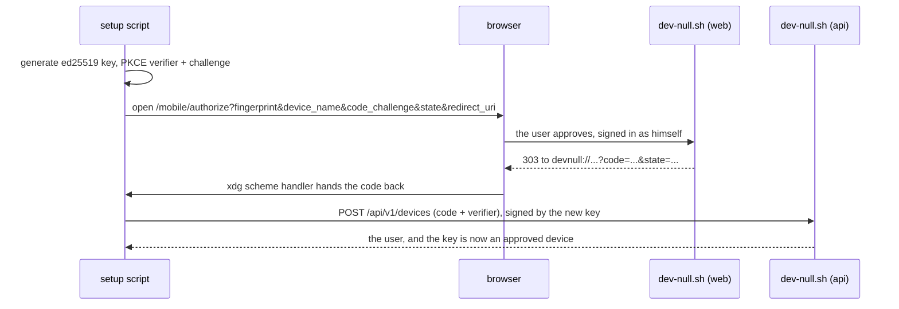

# dev-null in the Omarchy bar — design

2026-10-21

## What this is for

[dev-null.sh](https://dev-null.sh) is a social network for developers dressed as
git: posts are "commits" with a short hash, likes are stars, replies branch off
a thread drawn as lanes. It is a Laravel + Inertia app by Nuno Maduro, and its
source is public at `nunomaduro/dev-null.sh` (branch `production`).

The owner of this plugin wants two things while working, without a browser
window in the way: **to see the feed go by**, and **to notice when somebody
replies to him**. Once he has noticed, he wants the two cheap answers in place —
**a star** and **a reply** — and nothing else. Quoting, images, polls, search,
profiles and private messages are a click away on the site, and that is where
they stay.

So this is a reader with two buttons, not a client.

## Goals

1. An icon in the Omarchy bar that is quiet when there is nothing, and carries a
   count when there are unread notifications.
2. A panel that opens from it with, top to bottom: what happened to you, then
   the feed.
3. Star and un-star a commit from the panel.
4. Reply to a commit from the panel.
5. Click anything and the browser opens on its permalink.
6. It looks like the rest of the desktop: Omarchy theme colours, monospace body
   text, short hash shown as the site shows it.

## Non-goals

Writing a top-level commit, quoting, images, polls, the four feed tabs, search,
profile pages, following, muting, blocking, `remotes` (the private messages),
more than one account, and notifications on the desktop (the bar is the
notification).

## Anti-goals

These would make it a failure even if every feature worked:

- **Scraping HTML.** The site has a real API; parsing its markup would be a
  worse plugin that breaks on a restyle.
- **Touching the user's web session.** No cookie stealing, no headless browser.
- **A noisy bar.** The icon stays dark unless something is genuinely unread.
- **Eating his unread state.** Listing notifications marks them read everywhere;
  the plugin must never do that behind his back.
- **A key with more power than the job.** The signing key must not be able to
  sign git commits or log in anywhere else.
- **Lying about a reply.** Replies are moderated; the panel shows the state the
  server returned, never an optimistic "posted".
- **Polling hard enough to get throttled or noticed.**

## What the site already gives us

All of this was read from the public repo, not guessed.

### The API

`routes/api.php` defines a real `/api/v1`, built for the official mobile app:

| Need | Call |
|---|---|
| The feed | `GET /api/v1/log/{log}` |
| Notifications | `GET /api/v1/notifications` |
| Who am I | `GET /api/v1/me` |
| Star | `POST`/`DELETE /api/v1/commits/{id}/star` |
| Reply | `POST /api/v1/commits` with `body` and `parent_id` |
| One commit, with its ancestors | `GET /api/v1/commits/{id}` |

A handful of read endpoints (a user, their commits, followers, following, a
single commit) also answer unsigned, as a guest. Everything in the list above
needs a signature.

### How a request is signed

From `app/Services/SignedRequests.php`:

- The signed message is `<unix timestamp>\n<nonce>\n<METHOD>\n<path and query>\n<body>`.
- It travels in three headers: `X-Devnull-Timestamp`, `X-Devnull-Nonce`,
  `X-SSH-Signature`.
- The signature is an SSH signature in the namespace **`devnull-api`**, which is
  what `ssh-keygen -Y sign -n devnull-api` produces. A namespace scopes a
  signature: this one cannot sign a git commit or authenticate anywhere else.
- A body must be JSON. The raw bytes are what is signed.
- The nonce is spent once and the timestamp has to be fresh.

The server finds the user by the key's fingerprint, among the keys approved as
devices. **The key does not have to be on GitHub** — the approval is the proof.
That is stated in the source, and it is why this plugin uses a key of its own.

### How a key becomes a device

`MobileAuthorizationController` plus `CreateDevice`: an OAuth-shaped PKCE flow.

Two things that flow decides for us:

- `config/mobile.php` only allows a `redirect_uri` starting with **`devnull://`**.
  There is no localhost option. So the setup has to register a
  `x-scheme-handler/devnull` desktop entry to catch the code.
- The code is single-use and expires, and a second redemption gets nothing.

### The limits, measured

`AppServiceProvider` sets `throttle:api` to **120 requests a minute** for a
signed-in user, and stars to 60 a minute. Polling once a minute is two orders of
magnitude below the ceiling; the worry raised early on was unfounded.

### Moderation

`CreateCommit` stores a new commit as `Approved` only if the user is an admin or
`hasGoodReputation()`; otherwise it is `Pending` and a job moderates it. A reply
sent from the panel can therefore come back pending, and the panel has to say
so. Separately, `RequireCommitRules` rejects commits from a user who has not
accepted the commit rules on the website — a one-off the setup script tells him
to go do.

## How it is built

Decisions made here, not asked for. Anything unmarked is open to the builder.

### Shape

An Omarchy 4.0.4 bar-widget plugin, laid out like the author's own
`zangetsu.electroline`: `manifest.json` with `schemaVersion: 1`, a `Panel.qml`
entry point, a `Service.qml` holding the state, a `Model.js`, a `scripts/`
directory and `tests/`.

QML does not sign anything. A single small CLI, `scripts/devnull`, does the
signing and the HTTP, prints JSON on stdout, and is the only thing that touches
the key. `Service.qml` runs it and parses what comes back. This is how
electroline already talks to its backend, and it means the whole protocol is
testable from a terminal with no desktop running.

### The key

- A dedicated `ed25519` key in `~/.local/share/omarchy-devnull/`, mode 0600.
- Never added to the SSH agent, never uploaded to GitHub, used for nothing else.
- If it is lost, the setup runs again and approves a new device; the old one can
  be revoked on the site.

### Pairing

`scripts/setup-devnull` does the whole flow in the diagram above: generates the
key, writes and registers the `devnull://` handler, opens the authorize page,
waits for the code, redeems it, and finishes by telling him to accept the commit
rules on the site if he has not.

### Polling, and the trap in it

`GET /api/v1/notifications` **marks every relevant notification as read**, just
by listing them, whatever `?type=` filter is sent. Its own docblock says so, and
`UpdateNotificationsReadAt` does it before the query runs. Polling that endpoint
would quietly empty his inbox on the website and in the official app.

The side-effect-free count is `unread_notifications_count`, returned by
`GET /api/v1/me`. So:

- **Panel closed, every 60 seconds:** `GET /api/v1/me`. Nothing else. The badge
  is that number.
- **Panel opened:** that, and only that, calls `GET /api/v1/notifications`.
  Opening the panel *is* reading them, exactly as opening the website is, so the
  read state it clears is the read state he just consumed. The response carries
  `read_at`, which marks the boundary between what he has now seen and what
  arrives next.
- **Panel open, every 20 seconds:** the feed only. Notifications are not
  re-listed while it sits open; they are already read.

Both intervals are manifest settings, as in electroline.

**The badge counts every kind of notification** — replies and mentions, but also
stars, follows and moderation outcomes — because `/me` gives one total and no
breakdown. Narrowing it to replies would mean calling the destructive endpoint
on a timer, which is the one thing this design refuses. A slightly broader badge
is the price, and it is paid once per glance.

### The panel

- **Top: what happened to you.** From `GET /api/v1/notifications`. Each row says
  who and what, with enough of the body to recognise it.
- **Bottom: the feed.** `GET /api/v1/log/{log}` for the **Latest** log — the tab
  the site itself opens on, and the one that is not empty when you follow three
  people. Each entry: short hash, `@handle`, body clamped to two lines, star
  count.
- **Star** is one tap, applied optimistically and rolled back if the call fails.
- **Reply** opens a one-line field under the entry. After sending, the row shows
  what the server returned: posted, or waiting for moderation.
- **Anything else** opens the commit's `html_url`, which the feed already
  carries, in the browser.

A reply that comes back `Pending` is reported once, at send time, and then
forgotten. The plugin does not track it: moderation ends in an `approved` or
`rejected` notification, which the panel already shows. The loop closes itself
for free.

**A dead pairing is not a quiet failure.** A revoked device or a lost key makes
every call 401 forever. After three consecutive 401s the icon goes to a distinct
broken state and the panel says to run the setup again. That is not noise; it is
the plugin admitting it no longer works.

### Checking it works

There is no sandbox: every reply sent while testing is a real public commit
from his real account, under live moderation and throttling.

So `tests/` gets a mock server, as electroline's `tests/mock-cloud` already
does for its own backend, and the reply and star paths are exercised against
that. Against the real site, two things only: a signed `GET /api/v1/me`, which
proves the signing scheme end to end and changes nothing, and — once, by hand,
when he is ready — a single reply to one of his own commits.

The body clamping and the hash formatting get plain unit checks in `Model.js`.

This also fixes the order of the work: nothing past the signing scheme can be
tried until he has run the pairing flow in his own browser.

## Risks worth saying out loud

- **The `devnull://` scheme belongs to the official app.** We are using the
  pairing flow it was built for. It works, and the account is the user's own,
  but it is not a sanctioned third-party API: a client id, an allowlist or a
  change of scheme upstream would break pairing. Nothing else in the plugin
  depends on it once a device is approved.
- **If pairing ever closes**, posting still has a second door: `/api/cli/commits`,
  the path behind `curl -fsSL https://dev-null.sh/commit | bash`, which signs
  with a key published on the user's GitHub account in the `devnull-commit`
  namespace and supports `--reply`. It gives no feed and no notifications, so it
  is a fallback for half the plugin, not a replacement.
- **The site is weeks old** and its API is undocumented. Response shapes can
  change under us; the plugin should fail to a quiet icon, never to a broken bar.

## Left to the builder

The exact QML layout and spacing, how notifications of the same kind are
grouped, how many entries are kept in memory, the wording of errors, and whether
the feed and the notifications share one list component or two.
